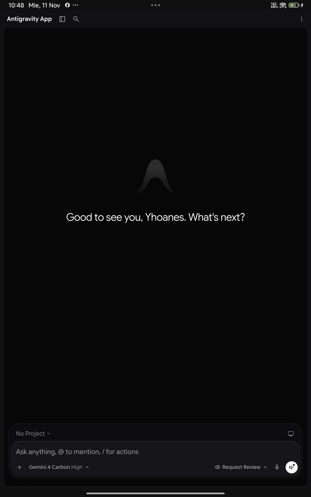
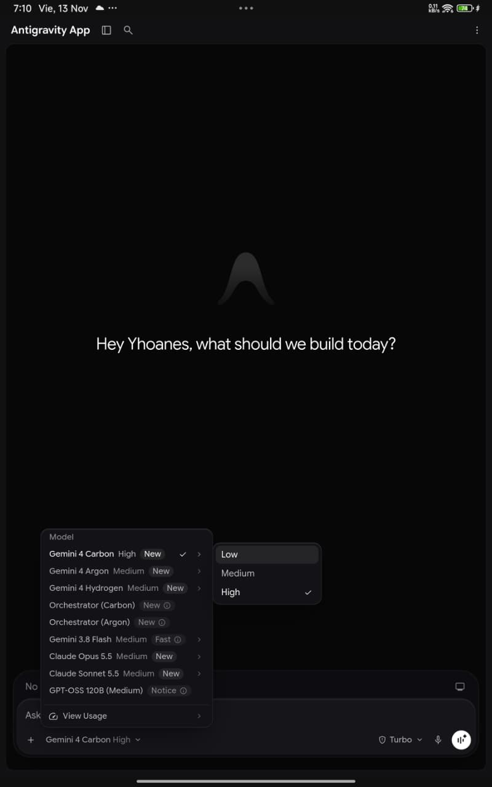
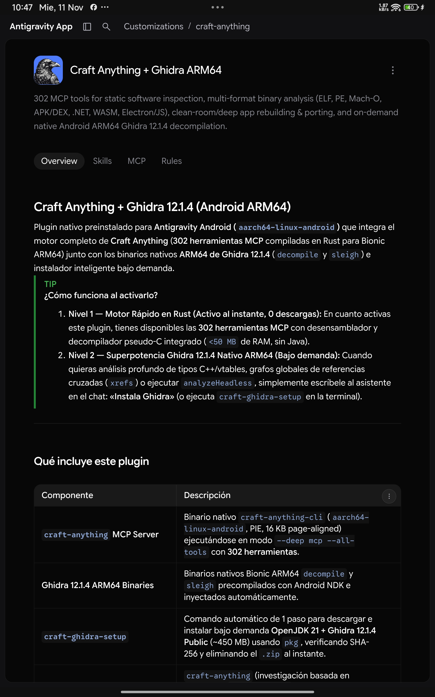
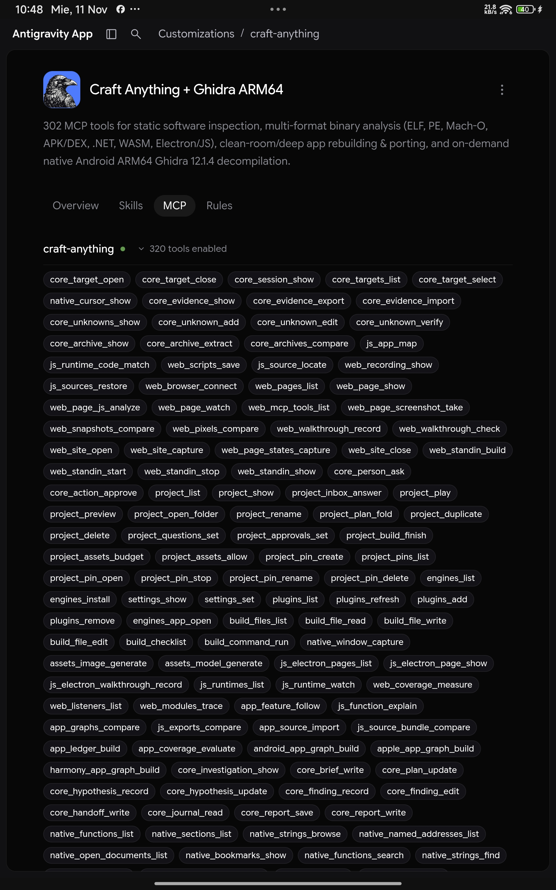
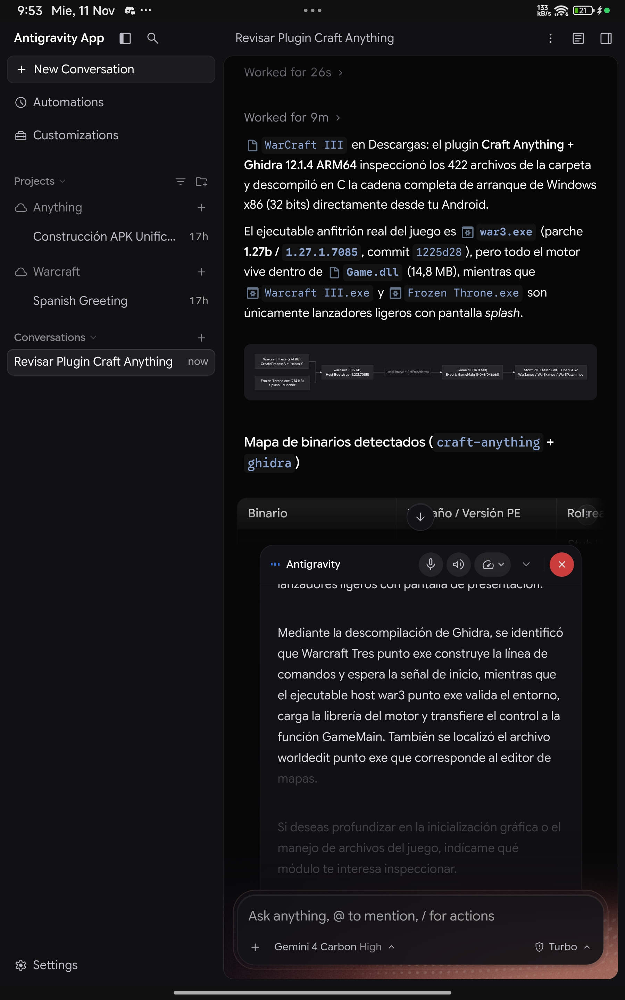
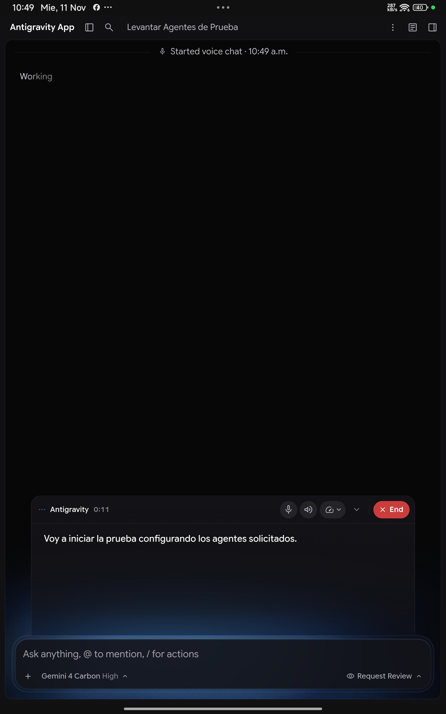
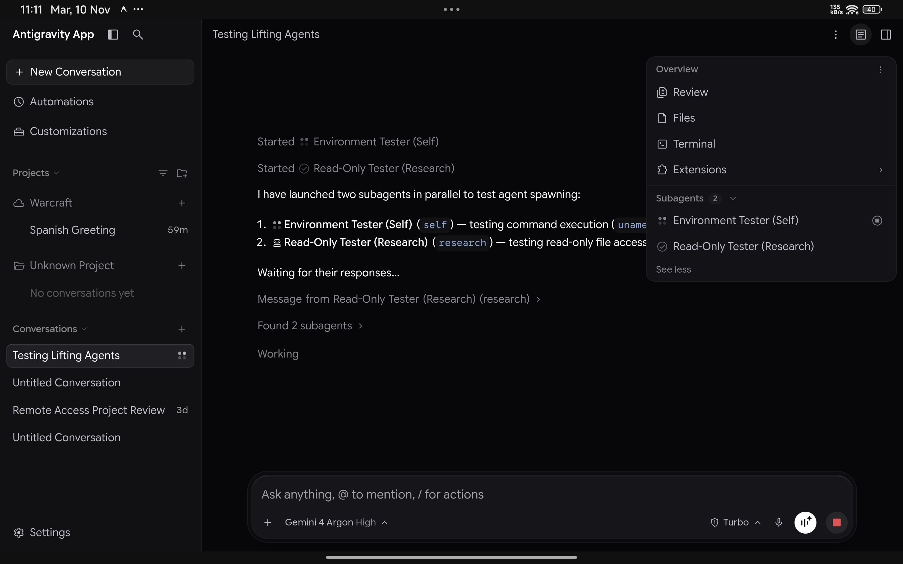
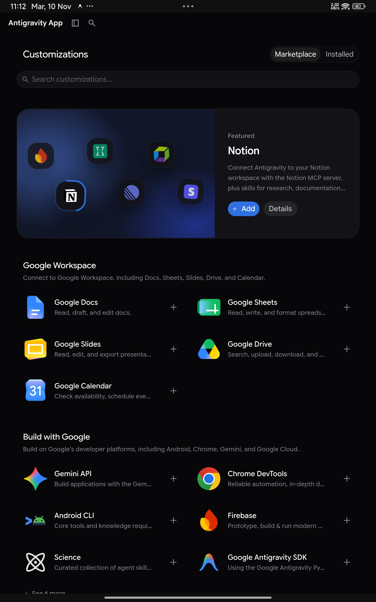
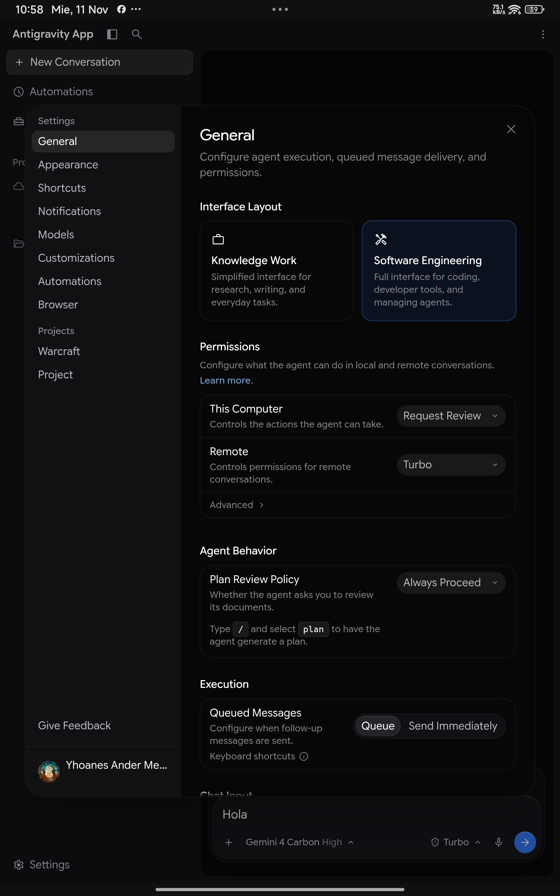

<div align="center">

  <br/>

  

  <p><font size="6"><b>Antigravity for Android</b></font></p>

  <p><font color="#7d8590">Autonomous agentic development &amp; native reverse-engineering environment engineered for Android ARM64.</font></p>

  <p>
    <code>v2.31.1</code> &nbsp;&bull;&nbsp;
    <code>Android 7.0+</code> &nbsp;&bull;&nbsp;
    <code>ARM64 v8.0-A+</code> &nbsp;&bull;&nbsp;
    <code>Smart Android Marketplace</code> &nbsp;&bull;&nbsp;
    <code>AGY Video Studio (GPU)</code> &nbsp;&bull;&nbsp;
    <code>Craft Anything + Ghidra 12.1.4</code> &nbsp;&bull;&nbsp;
    <code>Live Voice Mode</code> &nbsp;&bull;&nbsp;
    <code>Shizuku Ready</code> &nbsp;&bull;&nbsp;
    <code>BY-NC / Apache 2.0</code>
  </p>

  <br/>

  <!-- Hero Visual -->
  
  <p align="center"><font size="2" color="#7d8590">Antigravity v2.31.1 autonomous agent workspace on Android with Gemini 4 Carbon High &amp; Live Voice Mode</font></p>

</div>

---

<p><font size="5"><b>Architectural Overview</b></font></p>

**Antigravity for Android (`v2.31.1`)** brings Google's autonomous agentic coding engine and a full native binary reverse-engineering suite directly to mobile operating systems.

Unlike terminal-based chat wrappers or virtualized environments (PRoot, QEMU, chroot), Antigravity executes **natively inside Android userspace (Bionic)** within the application process. Powered by next-generation models (**Gemini 4 Carbon**, **Gemini 4 Argon**, **Gemini 3.8 Flash**, **Claude Opus 5.5**, **Claude Sonnet 5.5**, and **GPT-OSS 120B**), the agent autonomously inspects codebases, decompiles multi-architecture binaries, edits project trees, executes build tools, and validates results directly on physical mobile hardware.

> [!NOTE]
> **Bare-Metal Execution with Transparent Compatibility:** Processes run directly on the host CPU via a hybrid Bionic/Glibc loader without virtualization penalties, taking full advantage of UFS storage throughput and ARMv8.1-A+ Large System Extension (LSE) atomics (with transparent userspace `SIGILL` emulation for ARMv8.0-A CPUs via `liblse_compat.so`).

---

<p><font size="5"><b>Key Capabilities</b></font></p>

<table width="100%" style="border-collapse: separate; border-spacing: 8px; border: none;">
  <tr>
    <td width="50%" valign="top" style="border: 1px solid rgba(128, 128, 128, 0.2); border-radius: 12px; padding: 16px;">
      <p><font size="4"><b>Autonomous Multi-Model Agent</b></font></p>
      <p><font color="#7d8590">End-to-end engineering with <b>Gemini 4 Carbon/Argon</b>, <b>Claude 5.5</b>, and parallel subagents (<code>self</code>, <code>research</code>): task planning, multi-file refactoring, compilation, and automated diagnosis.</font></p>
    </td>
    <td width="50%" valign="top" style="border: 1px solid rgba(128, 128, 128, 0.2); border-radius: 12px; padding: 16px;">
      <p><font size="4"><b>Smart Android Marketplace &amp; Video Studio</b></font></p>
      <p><font color="#7d8590">Live <b>Built for Android</b> OTA shelf featuring <b>AGY Video Studio</b> (<code>h264_mediacodec</code> GPU rendering, neural TTS &amp; CapCut drafts), <b>GitHub MCP</b> (91 tools), headless Chromium MCP, and Bionic Go DNS bridging (<code>libagy-go-dns.so</code>).</font></p>
    </td>
  </tr>
  <tr>
    <td width="50%" valign="top" style="border: 1px solid rgba(128, 128, 128, 0.2); border-radius: 12px; padding: 16px;">
      <p><font size="4"><b>Craft Anything + Ghidra 12.1.4 ARM64</b></font></p>
      <p><font color="#7d8590">1-tap auto-enabled reverse-engineering suite with <b>302 MCP tools</b> in Rust plus on-demand native Android ARM64 <b>Ghidra 12.1.4</b> (<code>decompile</code> &amp; <code>sleigh</code>) for ELF, PE, Mach-O, APK/DEX, .NET, and WASM analysis.</font></p>
    </td>
    <td width="50%" valign="top" style="border: 1px solid rgba(128, 128, 128, 0.2); border-radius: 12px; padding: 16px;">
      <p><font size="4"><b>Zero-Friction Terminal &amp; Stage-Isolated <code>pkg</code></b></font></p>
      <p><font color="#7d8590">Binary-patched <code>language_server</code> (<code>exebox</code> / <code>urpc.Fork</code> bypass), fast <code>O(1)</code> per-package staging in <code>$PKG_ROOT/stage</code> (<code>&lt;20 ms</code> prefix rewrite), and pre-bundled OpenJDK 21 TLS <code>cacerts</code>.</font></p>
    </td>
  </tr>
  <tr>
    <td width="50%" valign="top" style="border: 1px solid rgba(128, 128, 128, 0.2); border-radius: 12px; padding: 16px;">
      <p><font size="4"><b>Real-Time Voice &amp; Native Encoders</b></font></p>
      <p><font color="#7d8590">Bidirectional WebRTC/WebAudio voice sessions with live transcription, paired with native Bionic ARM64 <code>webp_encoder</code> and <code>webm_encoder</code> binaries for zero-dependency media processing.</font></p>
    </td>
    <td width="50%" valign="top" style="border: 1px solid rgba(128, 128, 128, 0.2); border-radius: 12px; padding: 16px;">
      <p><font size="4"><b>Shizuku (Rish) &amp; Async Daemon</b></font></p>
      <p><font color="#7d8590">Single-call Shizuku elevation (<code>uid=2000</code>) for system notifications (<code>agy-notify</code>) and APK installs, backed by a non-blocking multithreaded scheduler (<code>agy-daemon</code>) with 1 MB log rotation.</font></p>
    </td>
  </tr>
</table>

---

<p><font size="5"><b>Visual Feature Walkthrough</b></font></p>

### 1. Next-Generation Models & Touch Reasoning Controls (`v2.31.1`)

Select between **Gemini 4 Carbon High**, **Gemini 4 Argon**, **Gemini 3.8 Flash**, **Claude Opus 5.5**, **Claude Sonnet 5.5**, and **GPT-OSS 120B**. Touch-engineered submenu patches allow effortless selection of reasoning effort levels (`Low`, `Medium`, `High`) on mobile and tablet screens without requiring desktop hover events.

<br/>


<p align="center"><font size="2" color="#7d8590">v2.31.1 model selector with Gemini 4 Carbon/Argon, Claude 5.5, and touch-activated reasoning effort submenu</font></p>

<br/>

---

### 2. Native ARM64 Reverse Engineering: `Craft Anything` + `Ghidra 12.1.4`

Available in 1 tap from the **`Built for Android`** shelf in **Customizations &rarr; Marketplace** (auto-enabled upon installation), **`Craft Anything + Ghidra` (`v0.4.0-r8`)** combines two complementary reverse-engineering engines natively on ARM64:

* **Tier 1 — Instant Rust Binary & App Engine (`<50 MB` RAM, 0 Downloads):** Exposes **302 MCP tools** (`craft-anything-cli --deep mcp --all-tools`, compiled for `aarch64-linux-android` with 16 KB page alignment) for static binary triage (`ELF`, `PE`, `Mach-O`, `APK/DEX`, `.NET`, `WASM`, `Electron/JS`), function disassembly, fast pseudo-C decompilation, string/symbol indexing, game asset inspection, and structured clean-room rebuilding.
* **Tier 2 — On-Demand Native ARM64 Ghidra 12.1.4 (`craft-ghidra-setup`):** Pre-staged native Android Bionic ARM64 `decompile` and `sleigh` binaries paired with an automated 1-step installer (`craft-ghidra-setup`) that fetches `openjdk-21`, configures Java TLS `cacerts`, downloads & verifies **Ghidra 12.1.4 PUBLIC** (`SHA-256`), injects the ARM64 decompiler, configures SELinux-compatible dot-free temp directories (`$PREFIX/tmp/ghidra-*`), and exposes `analyzeHeadless` across the runtime.

<br/>


<p align="center"><font size="2" color="#7d8590">Craft Anything + Ghidra 12.1.4 ARM64 plugin overview and two-tier architecture</font></p>

<br/>


<p align="center"><font size="2" color="#7d8590">302 native MCP tools enabled for binary reverse engineering, call-graph recovery, and clean-room porting</font></p>

<br/>


<p align="center"><font size="2" color="#7d8590">Real-world test: Craft Anything + Ghidra 12.1.4 ARM64 decompiling 32-bit Windows PE binaries (Warcraft III) directly on Android while narrating findings via Live Voice Chat</font></p>

<br/>

---

### 3. Real-Time Bidirectional Voice Chat (`v2.31.1`)

Speak directly with the autonomous agent in real time. Powered by native WebRTC/WebAudio microphone bridging (`RECORD_AUDIO`, `MODIFY_AUDIO_SETTINGS`) and unlocked `v2.31.1` voice relay feature gates (`cascade-enable-voice`, `send_voice_button_variant`).

<br/>


<p align="center"><font size="2" color="#7d8590">Active bidirectional voice session with floating live transcript and audio controls</font></p>

<br/>

---

### 4. Multi-Agent Workspace & Parallel Subagents

Designed for autonomous multi-agent workflows: project sidebar, parallel subagent orchestration (`self`, `research`), live task status tracking, and integrated workspace overview (`Review`, `Files`, `Terminal`, `Extensions`).

<br/>


<p align="center"><font size="2" color="#7d8590">Parallel subagent spawning and live status tracking inside the v2.31.1 workspace</font></p>

<br/>

---

### 5. Customizations & Smart Android Marketplace Fusion

Browse and install both **native Android ARM64 plugins** and **official Antigravity plugins** directly from **Customizations &rarr; Marketplace**:
* **`Built for Android` Shelf (Shelf #1):** Features 1-tap auto-enabled native ARM64 plugins hosted live via [`antigravity-android-plugins`](https://github.com/Yhoanes/antigravity-android-plugins) — including **`AGY Video Studio` (`v2.1.3`)** (GPU `h264_mediacodec` video studio, neural TTS, CapCut drafts & Shizuku), **`Craft Anything + Ghidra` (`v0.4.0-r8`, 302 MCP tools)**, **`GitHub` (`v2.1.1-android`, 91 MCP tools + Bionic OAuth bridge)**, **`Chrome DevTools` (`v1.10.3-android`)** (headless ARM64 Chromium MCP), and **`Android CLI` (`v1.0.16625372-android`)** (on-device Shizuku `rish` workflows).
* **Official Shelves:** **Google Workspace** (Docs, Sheets, Slides, Drive, Calendar, Gmail), **Build with Google** (Gemini API, Firebase, Science, Google Antigravity SDK), and partner integrations, automatically normalized for Bionic ARM64 (`libagy-go-dns.so` DNS fix & sidecar cleanup).

<br/>


<p align="center"><font size="2" color="#7d8590">Smart Android Marketplace Fusion showing the live <b>Built for Android</b> shelf (AGY Video Studio, Craft Anything + Ghidra, GitHub MCP, Chrome DevTools, Android CLI) directly above Google Workspace</font></p>

<br/>

---

### 6. Execution Policies, Interface Modes & Settings (`v2.31.1`)

Configure agent autonomy and workspace layout from **Settings**:
* **Interface Layout:** Switch between **Knowledge Work** (streamlined research/writing view) and **Software Engineering** (full IDE, terminal, and multi-agent controls).
* **Execution & Permissions:** Configure **Request Review** vs **Turbo** auto-execution, plan review policies, queued message delivery, and **Desktop Mode** viewport switching.

<br/>


<p align="center"><font size="2" color="#7d8590">v2.31.1 General settings panel with Knowledge Work / Software Engineering modes and execution policies</font></p>

<br/>

---

### 7. Userspace & Production Runtime Optimizations

Every layer of the Android Bionic runtime has been hardened for low latency and zero storage bloat:

* **Multiplexed WebSocket ConnectRPC & Instant Background Resume (`wsTransport=3`):** Routes `StreamAgentStateUpdates` and ConnectRPC traffic over `/connect-websocket` (`2s` inactivity ping / `4s` dead-stream timeout with automatic HTTP fallback), pairs with `agy:host-resume` & `visibilitychange` socket liveness probing (`<1.2s` zombie-socket recovery after OAuth browser redirects or app switching), and prevents background `WebView.freeMemory()` stream stalls.
* **Direct Terminal Execution (`exebox` / `urpc.Fork` Bypass):** Binary-level patches in `liblanguage_server.so` (`initEscapeSbox`, `sbox_prep`, `resolveSandbox`, `isSandboxEnabled`, `ApplySettingsToConfig`) disable Linux desktop `CLONE_NEWUSER` / `seccomp` re-exec forks (`libloader.so: invalid argument`), allowing `run_command` to execute directly on Android whether `BypassSandbox` is `false` or `true`.
* **`O(1)` Staged Package Installation (`pkg`):** `pkg install` extracts each `.deb` into an isolated staging directory (`$PKG_ROOT/stage`), rewrites hardcoded Termux prefixes in `<20 ms` (instead of rescanning the entire `$PREFIX` tree), indexes package files in a single pass, removes downloaded `.deb` archives immediately after extraction, and synchronizes `runtime/bin` bridges once per transaction.
* **Out-of-the-Box OpenJDK 21 & Ghidra Support:** Pre-bundles the Java TLS truststore (`$PREFIX/etc/tls/certs/java/cacerts`), injects `JDK_JAVA_OPTIONS="-Duser.home=$HOME -Djava.io.tmpdir=$PREFIX/tmp"` across shells and runtime bridges, and uses self-safe glob patterns (`/data/[d]ata/...`) in `util.sh` and `agy-fix-paths`.
* **Non-Blocking `agy-daemon` & Single-Call `agy-notify`:** Background scheduled tasks and webhooks execute in asynchronous daemon threads with concurrency guards (`_RUNNING_TASKS`) and automatic `1 MB` log rotation (`daemon.log.1`). System notifications cache the bundled app icon (`$PREFIX/share/antigravity/logo.png`) and post via `cmd notification` in a single `rish -c` call.

---

### 8. Hardware Throughput & Diagnostics

Real-world test: the agent authored a custom Python I/O benchmark and executed multi-pass tests on physical storage. Sequential reads exceeded **1222 MB/s**, and random writes reached **84,395 IOPS**, proving native UFS throughput without emulation overhead.

| Operation | Block Size | Total Volume | Time (s) | Throughput (MB/s) | IOPS |
| :--- | :--- | :--- | :--- | :--- | :--- |
| **Sequential Write (`fsync`)** | 1 MB | 128 MB | 0.158 | 809.04 MB/s | 809 |
| **Sequential Read** | 1 MB | 128 MB | 0.105 | 1222.17 MB/s | 1,222 |
| **Random Write (`4K fsync`)** | 4 KB | 19.5 MB | 0.059 | 329.67 MB/s | 84,395 |
| **Random Read (`4K`)** | 4 KB | 19.5 MB | 0.337 | 58.00 MB/s | 14,848 |

---

<p><font size="5"><b>Installation &amp; Getting Started</b></font></p>

<table width="100%" style="border-collapse: separate; border-spacing: 8px; border: none;">
  <tr>
    <td width="33%" valign="top" style="border: 1px solid rgba(128, 128, 128, 0.2); border-radius: 12px; padding: 16px;">
      <p><font size="4"><b>1. Download APK</b></font></p>
      <p><font color="#7d8590">Releases are available under <a href="https://github.com/Yhoanes/antigravity-android/releases">Releases</a>:<br/><br/>
      &bull; <b><code>Antigravity-v2.31.1.apk</code></b> — full signed release with bundled Bionic toolchain and Smart Android Marketplace.<br/><br/>
      <i>Seamless in-place updates are supported across versions.</i></font></p>
    </td>
    <td width="33%" valign="top" style="border: 1px solid rgba(128, 128, 128, 0.2); border-radius: 12px; padding: 16px;">
      <p><font size="4"><b>2. Grant Permissions</b></font></p>
      <p><font color="#7d8590">Grant storage access (<code>MANAGE_EXTERNAL_STORAGE</code>) and microphone access for Live Voice Chat.<br/><br/>
      <i>(Optional)</i> Launch <b>Shizuku</b> and grant access for elevated ADB shell operations without root.</font></p>
    </td>
    <td width="33%" valign="top" style="border: 1px solid rgba(128, 128, 128, 0.2); border-radius: 12px; padding: 16px;">
      <p><font size="4"><b>3. Bootstrap &amp; Decompile</b></font></p>
      <p><font color="#7d8590">Install development toolchains or enable native Ghidra decompilation:<br/><br/>
      <code>pkg update &amp;&amp; pkg install git python nodejs</code><br/>
      <code>craft-ghidra-setup</code><br/><br/>
      Install <b>AGY Video Studio</b> or <b>Craft Anything + Ghidra</b> with <code>+</code> in <i>Customizations &rarr; Marketplace</i>.</font></p>
    </td>
  </tr>
</table>

---

<p><font size="5"><b>System Requirements</b></font></p>

<table width="100%" style="border-collapse: separate; border-spacing: 0; border: 1px solid rgba(128, 128, 128, 0.2); border-radius: 12px; overflow: hidden;">
  <thead>
    <tr>
      <th style="padding: 12px 16px; border-bottom: 1px solid rgba(128, 128, 128, 0.2);">Component</th>
      <th style="padding: 12px 16px; border-bottom: 1px solid rgba(128, 128, 128, 0.2);">Minimum Requirements</th>
      <th style="padding: 12px 16px; border-bottom: 1px solid rgba(128, 128, 128, 0.2);">Recommended Requirements</th>
    </tr>
  </thead>
  <tbody>
    <tr>
      <td style="padding: 12px 16px; border-bottom: 1px solid rgba(128, 128, 128, 0.2);"><b>CPU Architecture</b></td>
      <td style="padding: 12px 16px; border-bottom: 1px solid rgba(128, 128, 128, 0.2);"><b>ARMv8.0-A+</b> (Cortex-A53, A55, Kryo, Snapdragon 685+)</td>
      <td style="padding: 12px 16px; border-bottom: 1px solid rgba(128, 128, 128, 0.2);"><b>ARMv8.2-A / ARMv9</b> (Snapdragon 8 Gen 1+, Dimensity, Tensor)</td>
    </tr>
    <tr>
      <td style="padding: 12px 16px; border-bottom: 1px solid rgba(128, 128, 128, 0.2);"><b>RAM</b></td>
      <td style="padding: 12px 16px; border-bottom: 1px solid rgba(128, 128, 128, 0.2);">4 GB LPDDR4X</td>
      <td style="padding: 12px 16px; border-bottom: 1px solid rgba(128, 128, 128, 0.2);">8 GB+ LPDDR5 / LPDDR5X (for Ghidra 12.1.4 headless analysis)</td>
    </tr>
    <tr>
      <td style="padding: 12px 16px; border-bottom: 1px solid rgba(128, 128, 128, 0.2);"><b>Free Storage</b></td>
      <td style="padding: 12px 16px; border-bottom: 1px solid rgba(128, 128, 128, 0.2);">2 GB (runtime core + Craft Anything Rust engine)</td>
      <td style="padding: 12px 16px; border-bottom: 1px solid rgba(128, 128, 128, 0.2);">8 GB+ UFS (OpenJDK 21, Ghidra 12.1.4, and toolchains)</td>
    </tr>
    <tr>
      <td style="padding: 12px 16px; border-bottom: 1px solid rgba(128, 128, 128, 0.2);"><b>Android Version</b></td>
      <td style="padding: 12px 16px; border-bottom: 1px solid rgba(128, 128, 128, 0.2);">Android 7.0 (API 24)</td>
      <td style="padding: 12px 16px; border-bottom: 1px solid rgba(128, 128, 128, 0.2);">Android 12 – 16+</td>
    </tr>
    <tr>
      <td style="padding: 12px 16px;"><b>Privileges</b></td>
      <td style="padding: 12px 16px;">Standard User</td>
      <td style="padding: 12px 16px;">Shizuku (Active ADB Service)</td>
    </tr>
  </tbody>
</table>

---

<p><font size="5"><b>Repository Structure</b></font></p>

```text
antigravity-android/
├── app/        # Android Host, WebView, OnboardingSeeder, and process supervisors
├── build/      # Gradle-free deterministic build pipeline (aapt, javac, d8, apksigner)
├── bus/        # Modular shell bus, IPC helpers, and environment variable composers
├── config/     # Centralized environment configs (app.env, paths.env, tools.env)
├── core/       # Glibc runtime manifest, seed states, and native media encoders
├── docs/       # Architecture specifications, manuals, and high-res visual assets
├── env/        # Bionic toolchain, rootfs overlay, TLS cacerts, and pkg manager
├── patches/    # Low-level binary patches (Go pclntab, exebox/seccomp bypass, AArch64 gates)
├── plugins/    # Native Craft Anything MCP server + Ghidra 12.1.4 ARM64 plugin source
└── web/        # Workbench v2.31.1 UI, Smart Marketplace Fusion, touch patches, and audio relay
```

---

<p><font size="5"><b>Acknowledgments &amp; Attribution</b></font></p>

This project builds upon the foundational Android Bionic host architecture originally created by [werdio325-png/antigravity-android](https://github.com/werdio325-png/antigravity-android), with major architectural upgrades and expansions in this repository (`v2.31.1`), including:

* **Core Engine & Workbench Upgrade (`v2.31.1`):** Updated ARM64 `language_server` (`go1.28`), Workbench UI bundle (`Gemini 4 Carbon/Argon`, `Claude 5.5`), multiplexed ConnectRPC WebSocket transport (`wsTransport=3` + `agy:host-resume` recovery), OAuth redirect & touch input trigger fixes, and native `webp_encoder` / `webm_encoder` binaries.
* **Smart Android Marketplace Fusion & `AGY Video Studio`:** Live OTA plugin fusion via [`antigravity-android-plugins`](https://github.com/Yhoanes/antigravity-android-plugins) (`Built for Android` shelf), native GPU `h264_mediacodec` video studio (`AGY Video Studio`), native 91-tool `GitHub MCP` server, headless ARM64 Chromium MCP (`Chrome DevTools`), on-device `android` CLI bridge, and 16 KB-aligned `libagy-go-dns.so` Bionic DNS resolution for Go plugin CLIs.
* **Native ARM64 Reverse Engineering (`Craft Anything` + `Ghidra 12.1.4`):** 302-tool Rust MCP server (`craft-anything-cli`), native Android Bionic ARM64 Ghidra `decompile` & `sleigh` binaries, and automated on-demand `craft-ghidra-setup` installer.
* **Direct Terminal Execution & Production Runtime Hardening:** Binary `exebox` / `urpc.Fork` sandbox bypass in `liblanguage_server.so`, `O(1)` stage-isolated `pkg install`, pre-bundled OpenJDK 21 `cacerts`, multithreaded `agy-daemon` with log rotation, and single-call `agy-notify`.
* **Real-Time Voice Chat & ARMv8.0-A Compatibility (`liblse_compat.so`):** Native WebRTC/WebAudio microphone pipeline and custom `SIGILL` trap-and-emulate layer for `FEAT_LSE` atomics, `FEAT_RDM`, and `FEAT_FCMA` SIMD instructions.

---

<p><font size="5"><b>License, Copyright &amp; Attribution Terms</b></font></p>

**Copyright &copy; 2026 [Yhoanes](https://github.com/Yhoanes)** (`v2.29.0` – `v2.31.1` modifications, reverse-engineering suite integration, voice relay, runtime optimizations, documentation, and compiled APK distributions).

Pursuant to **Section 4 of the Apache License, Version 2.0**, all modifications, additions, and the derivative distribution in this repository are licensed under the **Non-Commercial &amp; Mandatory Attribution License** (see [`LICENSE`](LICENSE) and [`NOTICE`](NOTICE)):

* **Mandatory Attribution (`BY`):** Any fork, redistribution, modified version, or binary/APK distribution **must** retain the [`LICENSE`](LICENSE) and [`NOTICE`](NOTICE) files intact, credit **Yhoanes** as the author of the `v2.29.0` – `v2.31.1` engineering and expansions, and link back to [https://github.com/Yhoanes/antigravity-android](https://github.com/Yhoanes/antigravity-android).
* **Non-Commercial Use Only (`NC`):** Commercial sale, paid redistribution, paid bundling, or commercial monetization of this derivative work, its modifications, or its compiled APK binaries is **strictly prohibited** without prior written permission from **Yhoanes**.
* **Upstream Foundation:** The foundational Android Bionic host code derived from [werdio325-png/antigravity-android](https://github.com/werdio325-png/antigravity-android) remains licensed under the [Apache License 2.0](LICENSE).

<div align="center">
  <p><font color="#7d8590">Copyright &copy; 2026 <a href="https://github.com/Yhoanes">Yhoanes</a> &nbsp;&bull;&nbsp; <a href="LICENSE">Non-Commercial &amp; Attribution License</a> (Upstream base: <a href="LICENSE">Apache 2.0</a>)</font></p>
</div>
